# SECT0101 · TAK integrations

Open-source tools that bring more devices and data into TAK (ATAK, WinTAK, iTAK, CloudTAK) for public safety and emergency response. Docs, training and the full project list live at **[tak5.org](https://tak5.org)**.

  
  
  
  <a href="https://github.com/SECT0101/PineappleTAK-MK7">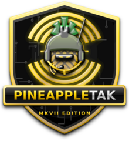</a>
  <a href="https://github.com/SECT0101/PineappleTAK-MK5.8-Tetra">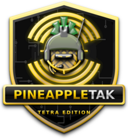</a>
  <a href="https://github.com/SECT0101/SharkTAKDisplay">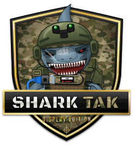</a>
  <a href="https://github.com/SECT0101/PagerTAKTheme">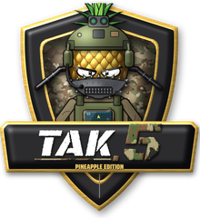</a>
  <a href="https://github.com/SECT0101/PagerMeshTheme">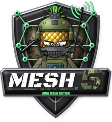</a>
  <a href="https://github.com/SECT0101/PagerRTTYTheme">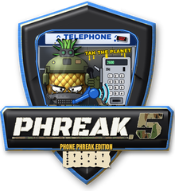</a>
  <a href="https://github.com/SECT0101/OpenWrt-TAK">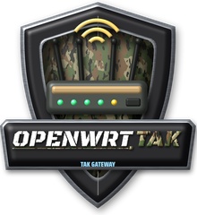</a>
  
  
  <a href="https://github.com/SECT0101/TurtleTAK-Classic">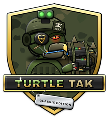</a>
  <a href="https://github.com/SECT0101/TurtleMesh">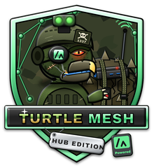</a>
  <a href="https://github.com/SECT0101/TurtleShell">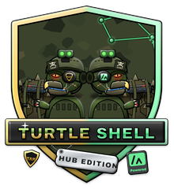</a>
  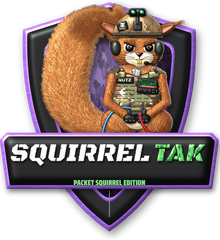
  
  
  

## Projects

| Project | What it does |
|---|---|
| [PagerTAK](https://github.com/SECT0101/PagerTAK) | Hak5 WiFi Pineapple Pager payloads: the Pager on the TAK map with GeoChat, alerts, field reports, Wi-Fi / Bluetooth / drone Remote ID sensors and a browser web console |
| [PagerMesh](https://github.com/SECT0101/PagerMesh) | Hak5 WiFi Pineapple Pager payload for Meshtastic: mesh chat, node list and map with navigation, radio settings and channels, mesh SIGINT and a mesh ↔ TAK bridge, with a web console. Glytch Mesh Mod, Wi-Fi or USB radio |
| [PagerRTTY](https://github.com/SECT0101/PagerRTTY) | Hak5 WiFi Pineapple Pager payload: position and field reports sent as RTTY through the Pager's buzzer, no network needed, with a receiver and Node-RED flow to put them on TAK, plus a Phone Phreak menu with the 2600 Hz whistle |
| [PineappleTAK-MK7](https://github.com/SECT0101/PineappleTAK-MK7) | Hak5 WiFi Pineapple Mark VII module: the Pineapple on the TAK map with GeoChat, alerts, reports, Wi-Fi / Bluetooth / drone sensors and the same web console as PagerTAK |
| [PineappleTAK-MK5.8-Tetra](https://github.com/SECT0101/PineappleTAK-MK5.8-Tetra) | Hak5 WiFi Pineapple Tetra module: the same for the Tetra, with Wi-Fi and drone sensors |
| [SharkTAKDisplay](https://github.com/SECT0101/SharkTAKDisplay) | Hak5 Shark Jack Display payload: wired network surveys (fingerprint with rogue DHCP detection, LLDP/CDP switch and VLAN, hosts and services, baseline diff for new devices, packet capture) sent to TAK as a marker plus a data package, with location from your own ATAK position |
| [TurtleTAK](https://github.com/SECT0101/TurtleTAK) | Hak5 LAN Turtle Hub payload: the Hub on the TAK map as a facility sensor, with network watch alerts (new devices, watched devices going missing, ARP spoofing, rogue DHCP, link tamper), site survey data packages, an ATAK mesh SA bridge and a web console with an offline map |
| [TurtleTAK Classic](https://github.com/SECT0101/TurtleTAK-Classic) | Hak5 LAN Turtle module for the original LAN Turtle and LAN Turtle SD: the Turtle on the TAK map as a facility sensor, with network watch alerts (new devices, watched devices going missing, link down, ARP spoofing) as markers and GeoChat, TLS with the Turtle's own ncat, and an alert log on the SD card |
| [TurtleMesh](https://github.com/SECT0101/TurtleMesh) | Hak5 LAN Turtle Hub payload: a Meshtastic radio over Wi-Fi or USB, with mesh chat, a node map, radio settings, mesh watch and sensor alerts, alerts over LoRa, DM commands, an optional mesh-to-TAK bridge (including ATAK plugin users) and a web console |
| [TurtleShell](https://github.com/SECT0101/TurtleShell) | Hak5 LAN Turtle Hub payload: TurtleTAK and TurtleMesh in one payload, sharing the radio's GPS fix, with a watchdog and both web consoles |
| SquirrelTAK *(private for now)* | Hak5 Packet Squirrel Mark II payload: an inline guard for one device on the TAK map, with alerts when it is unplugged, swapped or acts strangely, packet captures, a check-in / 911 panic button, quarantine from the web console or TAK chat, and a web console |
| BunnyTAK *(private for now)* | Hak5 Bash Bunny Mark II payload: the Bunny on the TAK map as a sensor on its USB host, with Bluetooth tracker and surveillance watch (including a *following* alert), watched devices, drone Remote ID, alerts, an offline Bluetooth log and a web console with an offline map |
| [PagerTAKTheme](https://github.com/SECT0101/PagerTAKTheme) | TAK5, a tactical coyote-tan theme for the WiFi Pineapple Pager: the TAK.5 shield, Tac-Pine, a TAK THE PLANET! boot finale and matching ringtones |
| [PagerMeshTheme](https://github.com/SECT0101/PagerMeshTheme) | MESH.5, a LoRa mesh theme in Meshtastic green for the WiFi Pineapple Pager, made to go with PagerMesh: the MESH.5 shield, Tac-Pine as a mesh operator, a MESH THE PLANET! boot finale and matching ringtones |
| [PagerRTTYTheme](https://github.com/SECT0101/PagerRTTYTheme) | PHREAK.5, an old-school phone phreak theme in payphone blue for the WiFi Pineapple Pager, made to go with PagerRTTY: Tac-Pine in the phone booth, rotary dials, Baudot tape, a PHREAK THE PLANET! boot finale and matching ringtones |
| [OpenWrt-TAK](https://github.com/SECT0101/OpenWrt-TAK) | `tak-gateway` for OpenWrt routers and Hak5 Pineapples: bridges local TAK multicast to a TAK Server, with a LuCI page |
| [NodeRED-TAK](https://github.com/SECT0101/NodeRED-TAK) | Ready-to-import Node-RED flows that put public data on the TAK map: weather and hazards, FEMA, wildfires, satellites, space weather, Winlink, Meshtastic and CalTopo |
| NodeRED-TAK-PS *(private, on request)* | Node-RED flows for public-safety TAK servers: TDOT SmartWay and Waze traffic, Tennessee transit (WeGo, MATA, CARTA, KAT, CTS, Rover, Amtrak) and 911 CAD calls. Shared with public-safety agencies and developers on request |
| LiveU-TAK *(private, on request)* | Node-RED flow: LiveU field units on TAK as live markers, with video links, status, alerts and a settings page. Shared with public-safety agencies and developers on request |

Downloads are on each project's **Releases** page.

---
Personal projects, shared as-is. Not affiliated with or endorsed by any agency, Hak5, LiveU, Meshtastic, Node-RED or the TAK Product Center.
